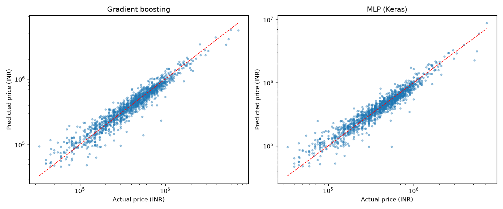
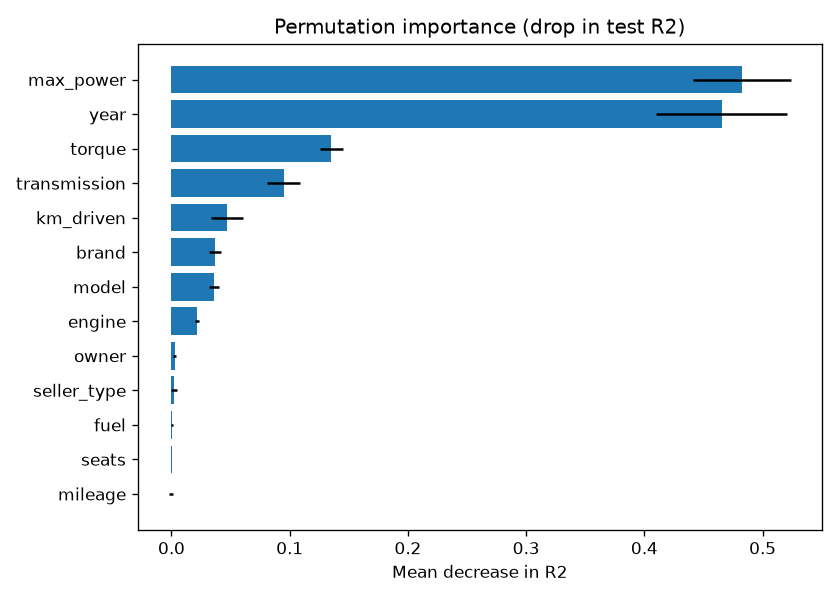
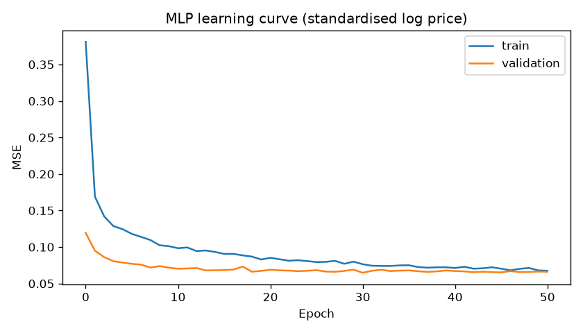

# Used car price prediction

Predicting used car prices from CarDekho listings (India). A Keras neural network is compared
with classical regression models, all trained in the same scikit-learn pipeline.

Gradient boosting does best, with R² = 0.925 on the test set and a mean absolute percentage
error of about 16%. The tuned MLP comes within 0.5% of its MAE.



## Results

The test set is 1,386 cars (20%) that were not used for training or tuning.
CV columns are 5-fold cross-validation on the training set.

| Model             |   CV R2 (mean) |   CV R2 (std) |   Test MAE (INR) |   Test RMSE (INR) |   Test MAPE (%) |   Test R2 |
|:------------------|---------------:|--------------:|-----------------:|------------------:|----------------:|----------:|
| Gradient boosting |          0.892 |         0.034 |           69,814 |           127,854 |            15.9 |     0.925 |
| MLP (Keras)       |          0.903 |         0.022 |           70,127 |           149,325 |            16.1 |     0.898 |
| Random forest     |          0.891 |         0.044 |           72,607 |           129,708 |            17.1 |     0.923 |
| Ridge regression  |          0.895 |         0.012 |           73,912 |           151,599 |            16.8 |     0.895 |
| Baseline (median) |         -0.052 |         0.012 |          259,547 |           478,963 |            79   |    -0.046 |

For scale, the median car in the data sells for 400,000 INR.

## Findings

The MLP matches gradient boosting on MAE but has a higher RMSE. Its errors are larger on
expensive cars, which are rare in the training data.

Plain ridge regression already reaches R² of about 0.90, so most of the accuracy comes from the
features and from predicting `log(price)` rather than from a more complex model.

The MLP architecture made little difference. All 12 configurations in the grid search
([results/mlp_grid.csv](results/mlp_grid.csv)) ended up between 76k and 79k INR CV MAE, which is
less than the variation between folds (2k to 7k).

Max power and year matter most, followed by torque and transmission type
(permutation importance on the test set):



## Data cleaning

See [src/data_prep.py](src/data_prep.py). The raw file has 8,128 listings.

- 1,202 rows (15%) are exact duplicates and are removed. Otherwise a random split puts the same
  listing in both train and test.
- Text columns such as `"23.4 kmpl"`, `"1248 CC"` and `"73.9 bhp"` are parsed into numbers.
- Torque appears in more than 15 formats (`190Nm@ 2000rpm`, `22.4 kgm at 1750-2750rpm`,
  `12.7@ 2,700(kgm@ rpm)` and others). Values in kgm are converted to Nm. Some values above 100
  are labelled kgm in the source but are really Nm, so they are kept as Nm. Values above
  0.4 Nm per cc of engine size are treated as missing; one 1.5 L hatchback is listed with 789 Nm.
- The car name has 2,058 unique values, so it is reduced to brand (32) and model (210). Models
  seen fewer than 10 times are grouped together.

## Modelling

See [src/models.py](src/models.py) and [src/tune_mlp.py](src/tune_mlp.py).

Imputation, scaling and one-hot encoding are steps in the pipeline, so they are fitted on the
training folds only. Prices range from 30k to 10M INR, so every model predicts `log(price)` and
is evaluated in INR.

The Keras MLP is wrapped as a scikit-learn estimator and goes through the same pipeline and
cross-validation as the other models. Early stopping uses a validation split taken from the
training data. Depth, width, dropout and learning rate were tuned with a grid search and 3-fold
CV on the training set.

Training converges after about 30 epochs. Validation loss is lower than training loss because
dropout is only applied during training.



## How to run

```bash
python -m venv .venv
.venv\Scripts\activate          # Linux/macOS: source .venv/bin/activate
pip install -r requirements.txt

python src/tune_mlp.py   # optional, ~5 min on CPU; writes results/mlp_best_params.json
python src/train.py      # trains all models, writes results/ (~5 min on CPU)
pytest                   # unit tests for the parsing logic
```

## Project structure

```
data/raw/car_details_v3.csv   raw dataset
src/data_prep.py              parsing and cleaning
src/models.py                 preprocessing pipeline, baselines, Keras MLP wrapper
src/tune_mlp.py               MLP hyperparameter search (CV on training data)
src/train.py                  final training, evaluation and plots
tests/test_data_prep.py       tests for the parsers
results/                      metrics and figures produced by the scripts
```

## Background

This started as a university project for a neural networks course in 2024. The first version
compared MLP, LSTM and GRU networks and reported R² of about 0.87, but that number was too
optimistic. The scalers and feature selection were fitted on the full dataset before splitting,
duplicate listings ended up on both sides of the split, and the best configuration was picked by
its test score.

This version fixes those three problems and adds classical baselines. LSTM and GRU were dropped:
each car is a single row, so a recurrent layer sees a sequence of length one and behaves like a
slower dense layer.

## Data

`data/raw/car_details_v3.csv` is "Car details v3.csv" from the
[Vehicle dataset](https://www.kaggle.com/datasets/nehalbirla/vehicle-dataset-from-cardekho) by
Nehal Birla on Kaggle, scraped from CarDekho listings. It is licensed under the
[Open Database License (ODbL)](https://opendatacommons.org/licenses/odbl/1-0/).
